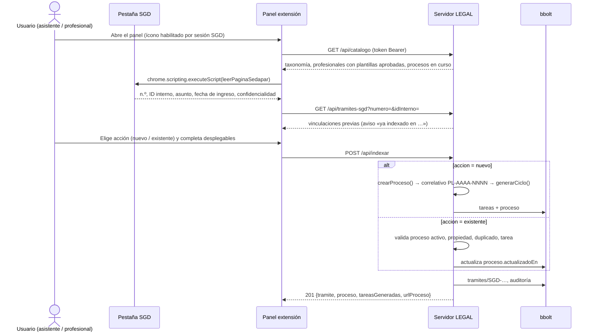
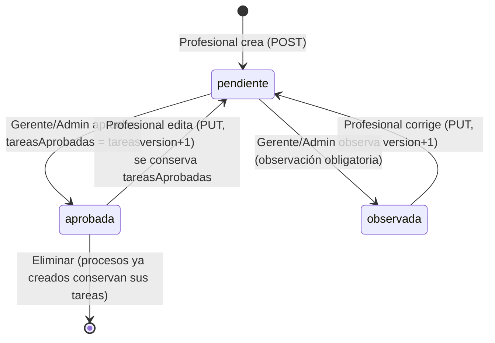

# 14 · Informe de análisis del sistema LEGAL (demo)

| | |
|---|---|
| **Alcance** | Repositorio `one-legal`: servidor Go (`servidor/`), portal web (`portal/`), extensión Chrome «Conector SGD» (`extension/`), SGD simulado (`pruebas/sgd-simulado/`) y documentación (`docs/11`–`13`) |
| **Versión analizada** | LEGAL 1.2 (commit `bc98e1e`) |
| **Fecha** | 2026-10-21 |
| **Propósito** | Describir la arquitectura actual de roles, la sincronización con el SGD, el flujo de indexación y la gestión de plantillas/categorías, y dejar identificados los puntos de mejora |

---

## 0. Vista general de la arquitectura

```mermaid
flowchart LR
  subgraph Navegador del usuario
    SGD[SGD SEDAPAR<br/>Angular SPA] -- DOM solo lectura --> EXT[Extensión Chrome MV3<br/>Conector SGD · panel lateral]
    PORTAL[Portal web<br/>HTML/CSS/JS sin dependencias]
  end
  EXT -- "REST JSON + Bearer token" --> API
  PORTAL -- "REST JSON + cookie HttpOnly<br/>sondeo cada 15 s" --> API
  subgraph LEGAL.exe (intranet)
    API[API HTTP Go<br/>servidor/api.go] --> BD[(bbolt NoSQL<br/>datos/legal.db)]
  end
```

| Capa | Tecnología | Archivos clave |
|---|---|---|
| Servidor / API | Go 1.24, `net/http` (rutas con método y comodines), un único ejecutable con los recursos web embebidos | `servidor/main.go`, `api.go`, `auth.go`, `ciclo.go`, `fechas.go`, `taxonomia.go`, `extension.go` |
| Persistencia | bbolt (clave-valor embebido). Cada colección es un *bucket*, cada documento un JSON | `servidor/bd.go` (colecciones: `usuarios`, `sesiones`, `plantillas`, `procesos`, `tareas`, `tramites`, `solicitudes`, `notificaciones`, `auditoria`, `sistema`) |
| Portal | SPA propia por *hash* (`#panel`, `#procesos`, `#proceso/{id}`…), menú por rol, sondeo periódico | `portal/js/app.js`, `nucleo.js`, `vistas-*.js`, `tareas.js` |
| Extensión | Chrome MV3, `sidePanel`, `scripting`, `declarativeContent`; lector específico SEDAPAR y lector genérico | `extension/panel/panel.js`, `shared/lector-sedapar.js`, `shared/lector.js`, `shared/servidor.js`, `background.js` |
| Seguridad transversal | PBKDF2-SHA256 (120 000 iteraciones), sesiones en BD, CORS solo para `chrome-extension://`, exigencia de `Content-Type: application/json` y verificación de `Origin` como protección CSRF | `servidor/auth.go`, `servidor/api.go` (`cabeceras`) |

Todas las escrituras que tocan varios documentos se serializan con un `sync.Mutex` del servidor (`Servidor.mu`); **no** se usan transacciones bbolt multi-documento (ver §5).

---

## 1. Estructura de los cuatro roles y sus funciones

### 1.1 Definición y control de acceso

Los roles están definidos en `servidor/modelo.go:32` (`rolesValidos`): `admin`, `gerente`, `profesional`, `asistente`. El control se aplica en dos niveles:

1. **Por ruta** — el *middleware* `con(manejador, roles...)` (`servidor/auth.go:136`) exige sesión válida y, opcionalmente, uno de los roles. Además bloquea toda escritura mientras el usuario tenga `debeCambiarClave`.
2. **Por regla de negocio dentro del manejador** — p. ej. un profesional solo opera sobre procesos con `ProfesionalID == su ID`, el asistente no puede cambiar el estado de un proceso, solo el administrador elimina procesos.

En el portal, el menú y las vistas permitidas se derivan de `MENUS[rol]` (`portal/js/app.js:10`); los botones se muestran con `L.es(...roles)` (`portal/js/nucleo.js:125`). **El portal solo oculta; la autorización real está en el servidor.**

### 1.2 Matriz de permisos (según el código del servidor)

| Operación (endpoint) | Admin | Gerente | Profesional | Asistente |
|---|:-:|:-:|:-:|:-:|
| Usuarios: alta, edición, baja (`/api/usuarios`) | ✔ | — | — | — |
| Taxonomía: categorías, vías, etapas base (`PUT /api/taxonomia`) | ✔ | — | — | — |
| Configuración de alertas y feriados (`PUT /api/config`) | ✔ | — | — | — |
| Base de datos: explorar, editar, respaldar, restaurar, vaciar (`/api/admin/*`) | ✔ | — | — | — |
| Crear / editar / eliminar plantilla (`/api/plantillas`) | ✔ (a nombre de cualquier profesional) | — | ✔ (solo las propias) | — |
| Aprobar / observar plantilla (`POST /api/plantillas/{id}/revision`) | ✔ | ✔ | — | — |
| Registrar proceso desde el portal (`POST /api/procesos`) | ✔ | — | ✔ (solo a su cargo) | ✔ |
| Indexar trámite SGD (`POST /api/indexar`) | ✔ | — | ✔ (solo sus procesos) | ✔ |
| Quitar una indexación (`DELETE /api/tramites/{id}`) | ✔ (cualquiera) | — | — | ✔ (solo las suyas) |
| Ver proceso (`GET /api/procesos/{id}`) | ✔ | ✔ | ✔ (solo propios) | ✔ |
| Editar datos del proceso / reasignar profesional | ✔ | ✔ | ✔ datos; ✘ reasignar | ✔ datos y reasignar |
| Cambiar estado del proceso (Activo / Suspendido / Finalizado) | ✔ | ✔ | ✔ (propios) | ✘ |
| Eliminar proceso | ✔ | — | — | — |
| Tareas: crear, editar, mover en el tablero, eliminar (`/api/tareas`) | ✔ | — | ✔ (procesos propios no finalizados) | — |
| Definir plazos en bloque (`PUT /api/plazos`) | ✔ | — | ✔ | — |
| Solicitar definición de plazo (`POST /api/solicitudes`) | ✔ | ✔ | — | ✔ |
| Marcar aviso de retroceso como visto (`POST /api/notificaciones/{id}/vista`) | ✔ | ✔ | — | — |
| Visibilidad de datos en `GET /api/datos` | Toda la cartera | Toda la cartera | **Solo sus procesos**, tareas, trámites y solicitudes | Toda la cartera |

### 1.3 Funciones específicas por rol

**Administrador** (`admin`)
- Único rol de configuración: usuarios y roles, taxonomía normativa, parámetros de alertas (`diasAlertaPorVencer`, `diasSinMovimiento`, `umbralVencidasPct`), feriados adicionales y nombre de la entidad.
- Mantenimiento de la BD: explorador de colecciones con edición JSON, respaldo/restauración, «vaciar datos operativos» o «vaciar todo».
- Superusuario funcional: puede hacer todo lo del profesional (tareas, plazos, plantillas en nombre de otro) y lo de la gerencia (aprobar plantillas).
- Restricciones de autoprotección: no puede quitarse el rol, desactivarse ni eliminarse a sí mismo; siempre existe al menos un administrador activo (`asegurarAdministrador`, `servidor/auth.go:66`).

**Gerente** (`gerente`)
- Lectura de toda la cartera: panel institucional (semáforo de salud, SPI, cumplimiento de plazos, desempeño por profesional, agenda), alertas de cartera (`carga-critica`, `retroceso-tarea`, `plantilla-por-aprobar`).
- **Gobierno de plantillas**: aprueba u observa (con comentario obligatorio al observar).
- Reasignar procesos, cambiar su estado y solicitar la definición de plazos.
- No edita tareas ni indexa trámites.

**Profesional** (`profesional`)
- Dueño operativo de sus procesos: tablero de tareas (Por hacer · En proceso · En revisión · Finalizada), ficha de tarea (descripción, checklist, color, comentarios), plazos uno a uno o en bloque, finalización del proceso (solo si todas las tareas están finalizadas).
- Autor de **sus plantillas** (una por vía procedimental), que se envían a aprobación.
- Puede indexar y registrar procesos, pero solo a su propio cargo; en la extensión solo se ve a sí mismo y a sus procesos.
- Retroceder una tarea exige justificación y genera una notificación persistente para la gerencia.

**Asistente administrativo** (`asistente`)
- Rol de **entrada de información**: indexa trámites del SGD con la extensión (proceso nuevo o anexo a existente) y registra procesos desde el portal.
- Ve toda la cartera; puede editar datos descriptivos y reasignar el profesional de un proceso; no cambia estados ni toca tareas.
- Solicita al profesional la definición de plazos pendientes.
- KPI propios: indexados por período, oportunidad de indexación (mediana ingreso SGD → indexación), anexos sin tarea relacionada.

### 1.4 Observaciones sobre roles

- **Discrepancia documentación ↔ código**: el `README.md` atribuye la reasignación al gerente, pero el servidor también la permite al asistente (`servidor/api.go:693-705`, mensaje «La reasignación la realiza la gerencia o el asistente»). Conviene decidir la regla y alinear ambos.
- **Separación de funciones**: el administrador puede crear una plantilla a nombre de un profesional y aprobarla él mismo. Si se requiere control por oposición, bloquear la autoaprobación (comparar `AprobadaPor` con el autor de la versión).
- **Exposición de datos**: `GET /api/datos` envía a todos los roles la lista completa de usuarios y **todas** las plantillas (el portal filtra en cliente). Para el profesional podría limitarse a sus plantillas.
- **Sesiones**: portal 12 h (`LEGAL_SESION_HORAS`), extensión 7 días fijos (`servidor/auth.go`). No hay bloqueo por intentos fallidos más allá de un retardo de 400 ms.

---

## 2. Sincronización con el Sistema de Gestión Documentaria (SGD)

### 2.1 Principios de diseño

La integración es **unidireccional y de solo lectura**: la extensión lee el DOM ya renderizado de la pestaña del SGD y envía los datos al servidor LEGAL. No hay API ni base de datos compartida con el SGD.

- No hace clics, no envía formularios, no llama a endpoints `/Rest/...` del SGD, no lee cookies ni almacenamiento web (`extension/shared/lector-sedapar.js:1-19`).
- No lee la tarjeta «DATOS DEL SOLICITANTE» ni el contenido del documento.
- **No actúa** en trámites con indicador de confidencialidad (componente `tramites-detalle-tramite-confidential` visible y con contenido).
- Base del diseño: `docs/11-reconocimiento-sgd.md`.

### 2.2 Activación y verificación de sesión

1. `background.js` registra reglas `declarativeContent`: el ícono se habilita solo si la URL empieza por un SGD configurado (`LEGAL_SGD_URLS`) **y** la página contiene un indicador de sesión (`app-layout`, `sidebar-cmp`, enlace a `/pages/login/exit`, etc.). Modo alternativo `dominio`: basta la URL.
2. Al abrir el panel, `verificarSesionSgd()` (`extension/panel/panel.js:184`) vuelve a comprobar: pestaña activa en un SGD, indicador de sesión presente, sin formulario de contraseña visible, página de detalle y no confidencial.
3. El panel sigue a la pestaña activa (`tabs.onActivated`, `tabs.onUpdated`, `windows.onFocusChanged`, con *debounce* de 350 ms) y relee al cambiar de trámite.

### 2.3 Lectores y datos extraídos

`leerPestana()` (`extension/panel/panel.js:146`) elige el lector según el perfil del SGD:

**a) Lector SEDAPAR** — `leerPaginaSedapar()` (`extension/shared/lector-sedapar.js:21`), usado en `sgd.sedapar.com.pe` y en `/sgd-simulado/`. Es asíncrono: espera con `MutationObserver` (tope 10 s) a que Angular pinte el trámite.

| Dato | Origen en el DOM | Regla | Campo LEGAL |
|---|---|---|---|
| N.º de trámite | Tres estrategias: **P** `legend.title .col-sm-5 > strong`; **R1** `strong` del *legend* «DATOS DEL EXPEDIENTE»; **R2** regex única dentro de la tarjeta del expediente | Consenso: si P y R1 discrepan → `AMBIGUOUS` (registro manual). Forma canónica `AAAA-#####-S` (p. ej. `2026 - 871 - 12` → `2026-00871-12`) | `nroTramite` |
| ID interno | Ruta `/tramites/detalletramite/{ID}` | Numérico; **no** es el n.º de trámite | `idInterno` |
| Asunto | Rótulo `ASUNTO` en la tarjeta del expediente → primer `p.text-muted` siguiente (antes del próximo rótulo); con alternativas `textarea/input`, `th/td`, `dt/dd`, texto del contenedor | Máx. 1000 caracteres; editable por el usuario | `asuntoSgd` |
| Fecha/hora de ingreso | Última fila (`tbody tr:last-child > td:first-child`) de la tarjeta «MOVIMIENTO DEL EXPEDIENTE» | Formato exacto `dd/mm/aaaa hh:mm:ss` | `fechaIngresoSgd` |
| Confidencialidad | `tramites-detalle-tramite-confidential` visible con texto | Si es `true`, el panel no muestra ni registra nada | (bloqueo) |
| Diagnóstico | `estrategias {P,R1,R2}`, `msDeteccion`, `motivo` (`NO_NODE`, `AMBIGUOUS`, `SIN_SESION`, `NO_DETALLE`) | Se muestra en el resumen de lectura | — |

**b) Lector genérico** — `leerPaginaSgd()` (`extension/shared/lector.js`), para otros SGD. Recorre hasta 6000 nodos buscando rótulos por sinónimos (normalizados sin tildes), etiquetas en línea («Asunto: …»), `id/name` de controles y un patrón de texto para «expediente». Se ejecuta en todos los *frames*.

| Dato leído (genérico) | Campo LEGAL |
|---|---|
| `nroExpediente` (o `nroRegistro` si no hay expediente) | `nroTramite` |
| `nroRegistro` (cuando sí hay expediente) | `idInterno` |
| `asunto` (asunto, sumilla, referencia, motivo) | `asuntoSgd` |
| `fechaDocumento` | `fechaIngresoSgd` |
| `tipoDocumento`, `nroDocumento`, `remitente`, `dependencia` | mismos nombres |
| `destinatario`, `estadoSgd` | **se leen pero no se envían** (no hay correspondencia en el panel) |

**c) Enlace al SGD** — se construye con la URL de la pestaña depurada de parámetros sensibles (`jsessionid`, `token`, `sid`, `csrf`…) o con una plantilla configurable `{nroTramite}`, `{idInterno}`, `{url}`.

### 2.4 Persistencia del trámite (`TramiteSGD`, `servidor/modelo.go:202`)

| Campo | Fuente |
|---|---|
| `nroTramite`, `idInterno`, `asuntoSgd`, `fechaIngresoSgd`, `enlaceSgd` | Extensión (lectura + corrección manual) |
| `tipoDocumento`, `nroDocumento`, `remitente`, `dependencia` | Extensión (solo lector genérico) |
| `estadoSgd` | Definido en el modelo, **nunca se llena** |
| `sgd` | Servidor: *host* del enlace |
| `detalle` | Usuario: asunto propio de la indexación (opcional) |
| `procesoId`, `tareaId`, `accion` (`nuevo`/`existente`) | Decisión del usuario |
| `indexadoPor`, `indexadoEn`, `id` (`SGD-…`) | Servidor |

### 2.5 Sincronización hacia el portal

No hay *push*: el portal hace sondeo de `GET /api/datos` cada 15 s (`portal/js/app.js:137-150`), por lo que lo indexado aparece «en segundos». El profesional recibe la alerta informativa «Nuevo documento SGD» cuando un tercero anexa un trámite a su proceso (ventana de 3 días).

### 2.6 Brechas detectadas en la sincronización

1. El lector SEDAPAR **no extrae** tipo de documento, remitente, dependencia ni estado, aunque el modelo los soporta y el SGD simulado los muestra (`pruebas/sgd-simulado/datos.js`: `tipo`, `remitente`, `estado`). Es la mejora de mayor valor inmediato, respetando la lista cerrada de `docs/11` (remitente institucional ≠ datos del solicitante).
2. `estadoSgd` y `destinatario` del lector genérico se descartan en `leerPestana`.
3. La fecha de inicio del proceso solo se deriva si `fechaIngresoSgd` tiene formato `dd/mm/aaaa`; con el lector genérico (formatos libres) el proceso inicia «hoy» sin aviso.
4. La sincronización es puntual (al indexar): si el trámite cambia en el SGD (nuevo movimiento, cambio de estado) LEGAL no se entera. Una «relectura» desde la ficha del trámite indexado sería la evolución natural.
5. El portal usa sondeo completo (todas las colecciones cada 15 s); con volumen creciente convendría `ETag`/versión de datos o *Server-Sent Events*.

---

## 3. Flujo de indexación de trámites a procesos nuevos o existentes

### 3.1 Secuencia general



### 3.2 Catálogo que alimenta los desplegables (`GET /api/catalogo`, `servidor/api.go:273`)

- **Profesionales activos** con la lista de **plantillas aprobadas** (`id`, nombre aprobado, vía, categoría, n.º de tareas). Si quien consulta es profesional, solo se ve a sí mismo.
- **Procesos en curso** (excluye `Finalizado`; incluye `Suspendido`), filtrados a los propios si es profesional.
- Taxonomía completa y URL del portal.

### 3.3 Validaciones comunes (`manejarIndexar`, `servidor/api.go:1061`)

- Obligatorio: n.º de trámite **o** ID interno (si solo hay ID, se guarda `"ID {idInterno}"`), asunto y enlace `http(s)`.
- `nroTramite` acotado por `^\S.{0,80}$`. En el panel SEDAPAR además se canoniza `AAAA-#####-S`.

### 3.4 Rama A — Crear un proceso nuevo

En el panel (`pintarNuevo`, `extension/panel/panel.js:288`) hay dos rutas de selección, recordadas como preferencia local:

| Criterio | Cascada | Filtro |
|---|---|---|
| *Primero el profesional* | Profesional → Vía (agrupada por categoría) | Solo vías con plantilla aprobada de ese profesional y no desactivadas |
| *Primero la categoría* | Categoría → Vía → Profesional | Solo categorías/vías con al menos una plantilla aprobada; luego los profesionales que la tienen |

En el servidor (`crearProceso`, `servidor/api.go:581`):

1. Título = título indicado o, por defecto, el asunto del SGD.
2. Fecha de inicio = fecha de ingreso del SGD (`dd/mm/aaaa`, no futura) o hoy.
3. La vía debe existir en la categoría y no estar desactivada.
4. El profesional debe estar activo; un profesional solo puede crear a su nombre.
5. Debe existir **plantilla aprobada** del profesional para la vía (`plantillaPara`, `servidor/ciclo.go:14`).
6. Código correlativo `PL-{año}-{NNNN}` con contador anual en `sistema` (`bd.Siguiente("proceso-AAAA")`).
7. `generarCiclo()` (`servidor/ciclo.go:27`) crea las tareas con la versión **aprobada** de la plantilla (ver §4.4).
8. Se guarda el proceso (`origen = "SGD"`), luego el trámite con `accion = "nuevo"`, y se audita.

### 3.5 Rama B — Anexar a un proceso existente

Panel (`pintarExistente`, `extension/panel/panel.js:341`): búsqueda por profesional o por categoría + vía, más texto libre; procesos agrupados «Categoría › Vía» con fecha de inicio. Un profesional siempre usa el criterio categoría/vía sobre sus propios procesos. Opcionalmente se elige una **tarea relacionada** (abiertas y concluidas, cargadas con `GET /api/procesos/{id}`).

Servidor:

1. El proceso debe existir y **no** estar finalizado.
2. Un profesional solo anexa a procesos propios.
3. **Control de duplicado**: si el mismo `nroTramite` ya está en ese proceso, responde `409 {duplicado:true}`; el panel ofrece «Registrar de todos modos» (`confirmarDuplicado: true`).
4. Si se indicó tarea, debe pertenecer al proceso.
5. Se actualiza `proceso.actualizadoEn` (cuenta como movimiento para la alerta «sin movimiento») y se guarda el trámite con `accion = "existente"`.

### 3.6 Después de indexar

- Pestaña **Mis indexaciones** (`GET /api/mis-indexaciones`): últimas 50 del usuario (todas si es admin) con acciones abrir en SGD, ver en portal, copiar enlace y quitar.
- Quitar una indexación borra solo el documento `TramiteSGD`; **no** revierte un proceso creado con `accion = nuevo`.

### 3.7 Brechas detectadas en la indexación

1. **Duplicados en «nuevo»**: el servidor no comprueba si el trámite ya originó otro proceso; solo el panel muestra un aviso informativo (`consultarRegistro`). Doble clic o dos asistentes pueden crear dos procesos para el mismo trámite.
2. **Atomicidad**: en `crearProceso` se consume el correlativo antes de generar el ciclo, y las tareas se guardan antes que el proceso y que el trámite, cada una en su propia transacción. Un fallo intermedio deja huecos en la numeración o tareas huérfanas. Recomendación: una sola `bolt.Tx` para correlativo + proceso + tareas + trámite.
3. `plantillaPara()` se invoca dos veces en `crearProceso` (`servidor/api.go:608` y `623`) recorriendo toda la colección; basta una.
4. El control de duplicado en «existente» compara `nroTramite` literal; un trámite registrado solo por ID interno (`"ID 250101"`) y luego por número no se detecta. Usar también `idInterno`.
5. Anexar a un proceso **suspendido** está permitido y el panel lo muestra; validar si es la regla deseada.
6. Al eliminar un proceso no se borran sus `notificaciones` (sí tareas, trámites y solicitudes).

---

## 4. Gestión de plantillas de tareas y categorías de procesos

### 4.1 Taxonomía: Categoría → Vía procedimental → Etapas base

Modelo (`servidor/modelo.go:70-117`): `Taxonomia{Categorias[]}` → `Categoria{Codigo, Nombre, BaseLegal, Vias[]}` → `Via{Codigo, Nombre, BaseLegal, Etapas[], Desactivada}` → `Etapa`.

Se guarda como **un único documento** `sistema/taxonomia`, inicializado con `taxonomiaBase()` (`servidor/taxonomia.go:24`) en el primer arranque:

| Código | Categoría | Vías | Base legal principal |
|---|---|:-:|---|
| CIV | Civil | 6 (conocimiento, abreviado, sumarísimo, cautelar, único de ejecución, no contencioso) | CPC |
| PEN | Penal | 5 (común, inmediato, terminación anticipada, querella, faltas) | NCPP (D. Leg. 957) |
| LAB | Laboral | 5 (ordinario, abreviado, impugnativo de laudos, cautelar, ejecución) | NLPT (Ley 29497) |
| CAD | Contencioso administrativo | 3 (urgente, ordinario, medida cautelar) | TUO Ley 27584 |
| CNS | Constitucional | 4 (amparo, hábeas data, cumplimiento, acción popular) | NCPCo (Ley 31307) |
| ARB | Arbitraje y medios alternativos | 4 (arbitraje de derecho, JPRD, conciliación, anulación de laudo) | D. Leg. 1071, Ley 32069, Ley 26872 |
| ADM | Administrativo | 5 (PAS, reconsideración, apelación, PAD, nulidad de oficio) | TUO Ley 27444, Ley 30057 |
| COA | Ejecución coactiva | 1 | TUO Ley 26979 |
| CON | Asesoría consultiva | 3 (opinión legal, contratos y convenios, proyecto normativo) | ROF |

**Total: 9 categorías y 36 vías.** Las etapas base usan los ayudantes `etH` (días hábiles), `etC` (calendario) y `etD` (plazo por definir), con referencia normativa por etapa.

**Edición (solo admin, `PUT /api/taxonomia`, `servidor/api.go:356`)**: se reemplaza el documento completo. Reglas:
- Código y nombre obligatorios; los códigos son únicos en un **espacio común** de categorías y vías.
- No se puede **quitar** una vía usada por un proceso o una plantilla (409); se ofrece **desactivarla**. Una vía desactivada no admite procesos nuevos ni aparece en la extensión ni en el editor de plantillas.
- Las etapas base son solo **punto de partida**: cambiarlas no modifica plantillas ni procesos existentes.

### 4.2 Plantillas de tareas: modelo

`Plantilla` (`servidor/modelo.go:119`) es de un **profesional** para **una vía** (una sola por par profesional–vía; la vía no se puede cambiar al editar):

| Campo | Significado |
|---|---|
| `tareas` | Versión en edición (la última enviada) |
| `estado` | `pendiente` (por aprobar) · `aprobada` · `observada` |
| `tareasAprobadas`, `nombreAprobado`, `aprobadaPor`, `aprobadaEn` | **Versión vigente** que genera procesos |
| `version` | Se incrementa en cada guardado |
| `observacion` | Comentario de la gerencia |

Cada tarea (`Etapa`) define: `nombre`, `plazoDias` (`null` = por definir), `tipoDias` (`habiles`/`calendario`), `desde` (`inicio` del proceso / fin de la `antecesora`), `antecesora` (`null` = la anterior; `-1` = ninguna, en paralelo; `k` = índice anterior), `referencia`, `descripcion`, `checklist`.

### 4.3 Ciclo de vida y aprobación



Reglas clave (`manejarPlantilla`, `servidor/api.go:421`; `manejarRevisionPlantilla`, `servidor/api.go:541`):
- Al guardar, la versión queda **pendiente**; mientras tanto **se sigue usando la última aprobada** (`Aprobada()` = existe `tareasAprobadas`).
- Validaciones: al menos una tarea, nombres no vacíos, plazo 0–3650, antecesora debe ser una tarea anterior, dueño con rol profesional, vía válida.
- Solo las vías con plantilla aprobada se ofrecen al crear procesos (portal y extensión).
- Alertas: `plantilla-por-aprobar` (gerente/admin, media) y `plantilla-observada` (profesional, alta).

Portal (`portal/js/vistas-plantillas.js`):
- `L.editorTareas` (`:12`) — editor tabular reutilizado también por la taxonomía: reordenar, duplicar, quitar, plazo/tipo/desde/antecesora/base legal, con resumen de días hábiles y calendario. **Al reordenar, todas las antecesoras explícitas se reinician** a «la anterior».
- `editarPlantilla` (`:171`) — al elegir la vía se precargan sus etapas base; también permite copiar tareas de otra plantilla.
- `revisarPlantilla` (`:143`) — vista lado a lado «versión propuesta» vs. «versión aprobada vigente» y botones Aprobar/Observar.

### 4.4 De plantilla a ciclo de tareas del proceso (`generarCiclo`, `servidor/ciclo.go:27`)

1. Copia cada etapa aprobada a una `Tarea` en estado `Pendiente` («Por hacer»), con checklist y referencia.
2. Resuelve `antecesoraId` por índice (por defecto la anterior).
3. Tareas sin antecesora: `fechaInicio = inicio del proceso` (habilitadas desde el día uno).
4. Si tienen plazo y cuentan desde el inicio (o no tienen antecesora): `fechaLimite` = inicio + plazo, con el calendario de feriados peruanos (`servidor/fechas.go`; los plazos en calendario que caen en día inhábil se prorrogan, TUO Ley 27444 art. 145).
5. Las demás se habilitan al finalizar su antecesora (`cambiarEstadoTarea`, `servidor/ciclo.go:93`): se fija `fechaInicio` y se calcula `fechaLimite` si tienen plazo relativo. Avanzar exige antecesora finalizada; retroceder exige justificación y notifica a la gerencia.
6. El proceso guarda `plantillaId` y `plantillaNombre` (trazabilidad de qué versión lo generó, aunque **no** el número de versión).

### 4.5 Brechas detectadas en plantillas y taxonomía

1. **Sin historial de versiones**: solo se guardan la versión en edición y la aprobada; no hay registro de qué versión generó cada proceso (`Proceso` no guarda `version`). Recomendado: `plantillaVersion` en `Proceso` y colección `plantillas_versiones`.
2. **Eliminación sin salvaguarda**: un profesional puede eliminar una plantilla aprobada sin confirmación del gerente; la vía deja de estar disponible de inmediato. Considerar baja lógica o aprobación.
3. **Profesional desactivado**: sus plantillas dejan de aparecer en el catálogo; al **reasignar** un proceso el ciclo no se regenera ni se vincula a la plantilla del nuevo profesional. Definir la regla de negocio.
4. **Plantillas institucionales**: no existe una plantilla «de la gerencia» por vía que puedan heredar varios profesionales; cada uno parte de las etapas base. Útil para homogeneizar criterios.
5. **Taxonomía como documento único**: cualquier edición reescribe todo y no lleva control de concurrencia (dos administradores pueden pisarse). Añadir `actualizadaEn` como versión optimista.
6. **Campos `descripcion` y `checklist` de las etapas** existen en el modelo y se copian a las tareas, pero el editor de plantillas no permite editarlos (solo los conserva).
7. El editor reinicia las antecesoras al reordenar: puede perder dependencias en paralelo (`-1`) definidas a propósito sin que el usuario lo advierta.

---

## 5. Resumen de mejoras priorizadas

| Prioridad | Mejora | Área | Archivos |
|:-:|---|---|---|
| Alta | Transacción única bbolt para correlativo + proceso + tareas + trámite | Indexación | `servidor/api.go` (`crearProceso`, `manejarIndexar`), `servidor/bd.go` |
| Alta | Control de duplicado en servidor también para «nuevo» y por `idInterno` | Indexación | `servidor/api.go` |
| Alta | Extraer tipo de documento, remitente (institucional), dependencia y estado en el lector SEDAPAR | SGD | `extension/shared/lector-sedapar.js`, `extension/panel/panel.js` |
| Media | Versionado de plantillas y `plantillaVersion` en el proceso | Plantillas | `servidor/modelo.go`, `servidor/api.go`, `servidor/ciclo.go` |
| Media | Definir y alinear la regla de reasignación (asistente sí/no) | Roles | `servidor/api.go`, `README.md` |
| Media | Impedir autoaprobación de plantillas por el administrador | Roles | `servidor/api.go` (`manejarRevisionPlantilla`) |
| Media | Relectura/actualización de un trámite ya indexado (estado, movimientos) | SGD | extensión + nuevo `PUT /api/tramites/{id}` |
| Media | Advertir cuando la fecha de ingreso no se pudo interpretar | SGD | `servidor/api.go`, `extension/panel/panel.js` |
| Baja | Filtrar plantillas/usuarios enviados al profesional en `/api/datos` | Roles | `servidor/api.go` |
| Baja | Sincronización incremental del portal (ETag o SSE) | SGD/Portal | `servidor/api.go`, `portal/js/app.js` |
| Baja | Borrar notificaciones al eliminar un proceso; evitar doble `plantillaPara` | Calidad | `servidor/api.go` |
| Baja | Editor de descripción y checklist por tarea en plantillas | Plantillas | `portal/js/vistas-plantillas.js` |

---

## 6. Referencias rápidas

- Roles y matriz de rutas: `servidor/api.go:45-103`, `servidor/auth.go:136`, `portal/js/app.js:10`.
- Modelo de datos: `servidor/modelo.go`.
- Indexación: `servidor/api.go:1047-1235`; panel `extension/panel/panel.js:146-463`.
- Lectores SGD: `extension/shared/lector-sedapar.js`, `extension/shared/lector.js`; reconocimiento en `docs/11-reconocimiento-sgd.md`.
- Plantillas: `servidor/api.go:421-578`, `servidor/ciclo.go:14-74`, `portal/js/vistas-plantillas.js`.
- Taxonomía: `servidor/taxonomia.go`, `servidor/api.go:356-417`, `portal/js/vistas-admin.js` (vista `taxonomia`).
- KPI y alertas: `docs/13-kpi-y-alertas.md`, `servidor/ciclo.go:186`.
